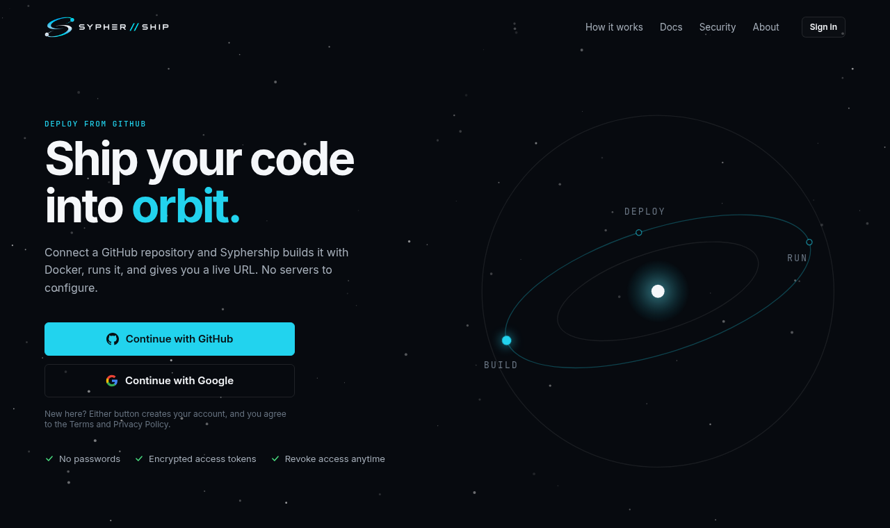
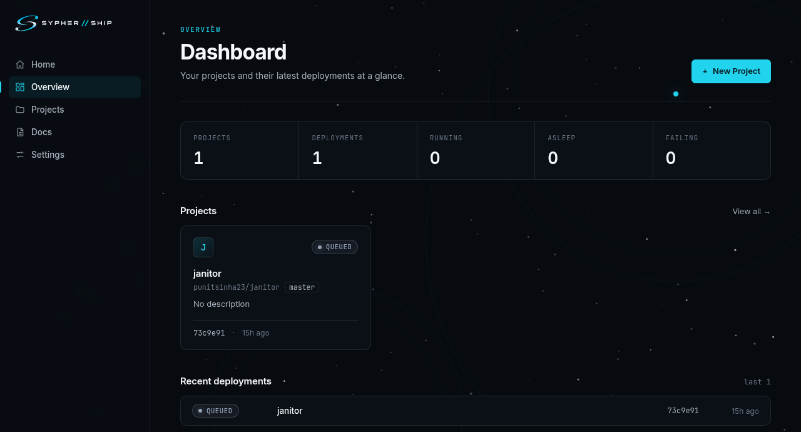

# Syphership

**From code to production.** A self-hosted deployment platform (a mini PaaS): sign in with GitHub, pick a repository, and Syphership builds it with Docker, runs it in a sandbox, and gives it a live HTTPS URL. After that, every `git push` redeploys it.

**Live:** [syphership.duckdns.org](https://syphership.duckdns.org)

[](https://github.com/punitsinha23/syphership/actions/workflows/ci.yml)



## What it does

- **Deploy from GitHub.** Sign in with GitHub (or Google, then connect GitHub), pick a repo and branch. Any language works, as long as the repo has a `Dockerfile`.
- **Push to deploy.** A GitHub webhook (HMAC-verified) starts a new deployment on every push.
- **HTTPS URL per app.** Each project gets `https://<name>-<id>.syphership.duckdns.org`, routed by Caddy with automatic Let's Encrypt certificates.
- **Live build logs.** Docker build output streams to the browser line by line (Server-Sent Events), and the full log is kept afterwards.
- **Zero-downtime redeploys.** Traffic moves to the new container before the old one is removed.
- **Idle apps sleep.** Apps nobody visits for 24 hours are stopped to free memory; the next visitor sees "Waking up…" for a few seconds while the app starts again.
- **Sandboxed user code.** Apps must run as non-root, with all Linux capabilities dropped, CPU/memory/process limits, and a separate Docker network.
- **Secrets stay secret.** GitHub tokens and app environment variables are encrypted at rest and scrubbed from logs.



## Architecture

```text
                    git push ──► GitHub ──webhook──┐
                                                   v
 Browser ──HTTPS──► Caddy ──► React app (static)   API (FastAPI) ──► PostgreSQL
                      │                              │
                      │                              └─ job ─► Redis Streams ─► Worker(s)
                      │                                                          │
                      │                                         git clone, docker build/run,
                      │                                         health check, Caddy routes
                      v                                                          v
          <name>-<id>.syphership.duckdns.org ──────────────────────────► user app container
```

- **API** (FastAPI): auth, projects, deployments, webhooks, live log stream, `/metrics`. Stateless; it never touches Docker.
- **Worker(s)**: take jobs from a Redis Streams consumer group and do everything that needs Docker. Run several for more builds at once.
- **PostgreSQL**: users, projects, deployments (the source of truth). **Redis**: job queue, live logs, rate limits, build metrics.
- **Caddy**: HTTPS for everything, and the per-app routes the worker writes.

More detail, including the deployment state machine and failure handling: **[docs/ARCHITECTURE.md](docs/ARCHITECTURE.md)**. Threat model: **[docs/SECURITY.md](docs/SECURITY.md)**.

## Tech stack

| Area | Technology |
|---|---|
| Backend | Python 3.14, FastAPI, SQLAlchemy, Alembic, Pydantic |
| Frontend | React 19, Vite, React Router |
| Data | PostgreSQL 15, Redis 7 (Streams, consumer groups) |
| Containers | Docker, Docker Compose |
| Edge | Caddy (reverse proxy, automatic HTTPS) |
| Auth | GitHub and Google OAuth, JWT access + rotating refresh tokens |
| CI/CD | GitHub Actions: ruff, pytest, eslint, build, then SSH deploy |
| Observability | JSON logs with request IDs, Prometheus `/metrics` |
| Hosting | One Ubuntu VPS (1 vCPU, 1 GB RAM) |

## Run it locally

Needs Docker, Python 3.14 and Node 24.

```bash
git clone https://github.com/punitsinha23/syphership.git
cd syphership
cp .env.example .env          # then set SECRET_KEY and your GitHub OAuth app

make up                       # PostgreSQL + Redis
cd services/api && python -m venv .venv && cd ../..
make install                  # API + dev dependencies
cd services/api && .venv/bin/alembic upgrade head && cd ../..

make api                      # API on http://localhost:8000
make worker                   # a build worker (second terminal)
cd frontend && npm ci && npm run dev   # UI on http://localhost:5173
```

Create a GitHub OAuth app with the callback `http://localhost:8000/github/callback` and put its ID and secret in `.env`. Locally, deployed apps get a `http://localhost:<port>` URL instead of a subdomain.

**Tests and lint:** `make test` (pytest, needs `make up`) and `make lint` (ruff + eslint).

## Deploying an app

The repository needs a `Dockerfile` at its root that:

1. `EXPOSE`s the port the app listens on,
2. sets a non-root `USER`,
3. starts a long-running process listening on `0.0.0.0`.

The in-app [Docs page](https://syphership.duckdns.org/docs) has examples for Node.js, Python and static sites.

## How it's deployed

Every push to `main` runs CI (ruff, ~400 backend tests against real PostgreSQL and Redis, eslint, frontend build). If everything passes, a deploy job connects to the VPS over SSH with its own deploy key and runs [`scripts/deploy.sh`](scripts/deploy.sh): check out the exact tested commit, build, migrate, restart, and wait for `/ready`. The frontend is built in CI and copied to the server. A daily `pg_dump` ([`scripts/backup.sh`](scripts/backup.sh)) keeps a week of database backups.

## Project status

Phases 0–7 of [PROJECT.md](PROJECT.md) are done. Ideas for later (container registry, Kubernetes, preview deployments, tracing) are in its backlog.
